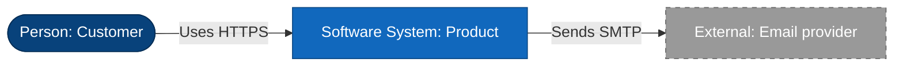
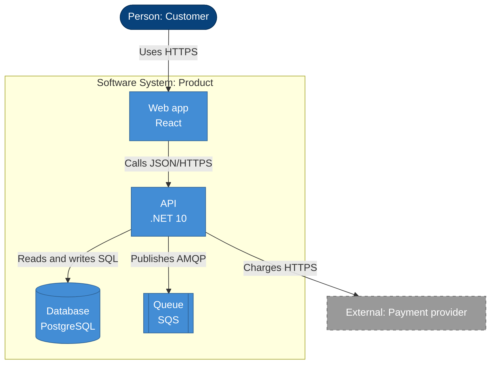

# Mermaid C4 Shapes

GitHub renders Mermaid `flowchart` blocks. It does not render `C4Context` or
`C4Container` blocks, so use the flowchart syntax below and keep the C4 meaning
through the legend and the shapes.

## Shape map

| C4 element | Mermaid | Class |
|---|---|---|
| Person | `(["Label"])` | `person` |
| Software system | `["Label"]` | `system` |
| Container | `["Label"]` | `container` |
| Database | `[("Label")]` | `store` |
| Queue | `[["Label"]]` | `store` |
| External system | `["Label"]` | `external` |
| Boundary | `subgraph id["Label"]` | none |

Use `<br/>` inside a label for a second line, for example
`api["API<br/>.NET 10"]`.

## Styles

```
classDef person fill:#08427B,color:#fff,stroke:#052E56
classDef system fill:#1168BD,color:#fff,stroke:#0B4884
classDef container fill:#438DD5,color:#fff,stroke:#2E6295
classDef store fill:#438DD5,color:#fff,stroke:#2E6295
classDef external fill:#999999,color:#fff,stroke:#666666,stroke-dasharray:5 5
```

External systems are dashed. Everything else follows the C4 blue palette.

## Context template



## Container template



## Rules

- One direction per diagram. Do not mix LR and TB.
- Keep labels short. Put the technology on the second line.
- Label every arrow with the intent and the protocol.
- Keep a diagram under about ten elements. Split it when it grows.
- Do not use `C4Context`, `C4Container`, `Person()`, or `Rel()` syntax. GitHub
  shows them as raw text.
